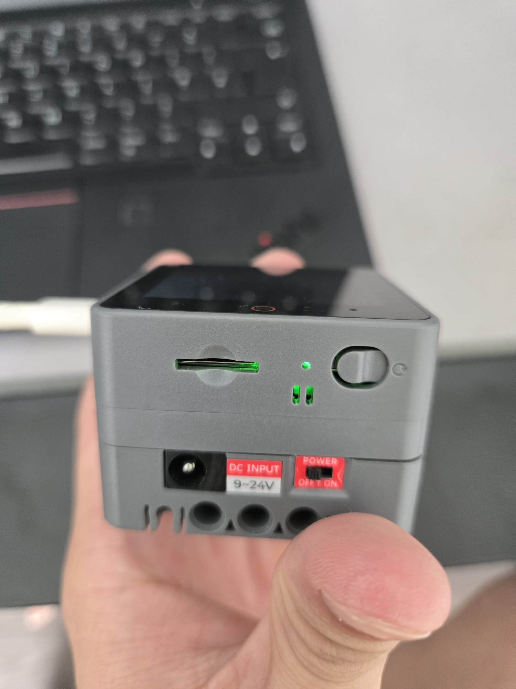
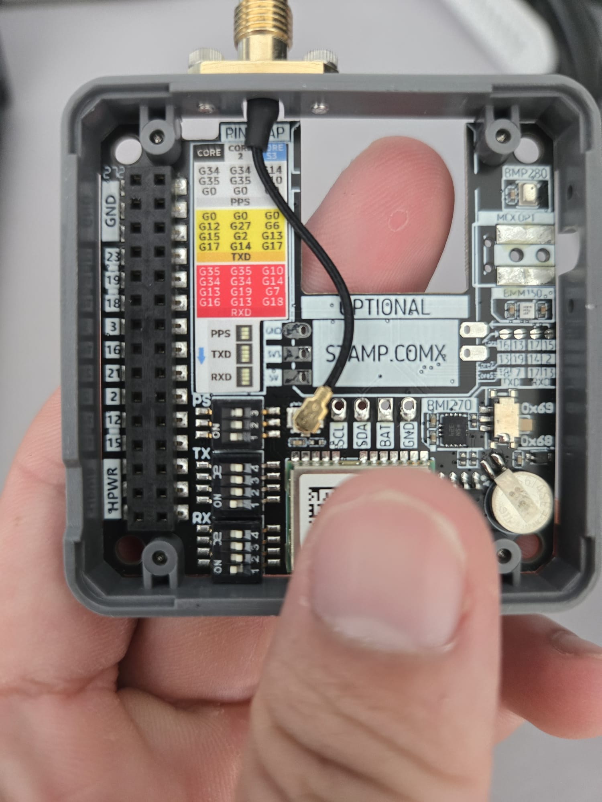
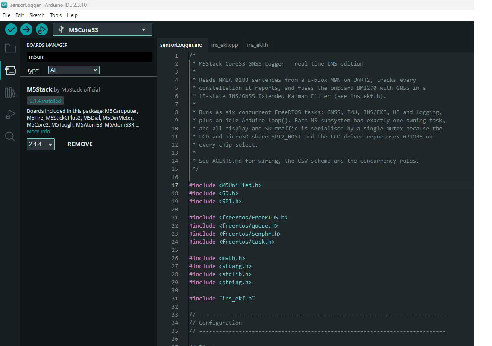
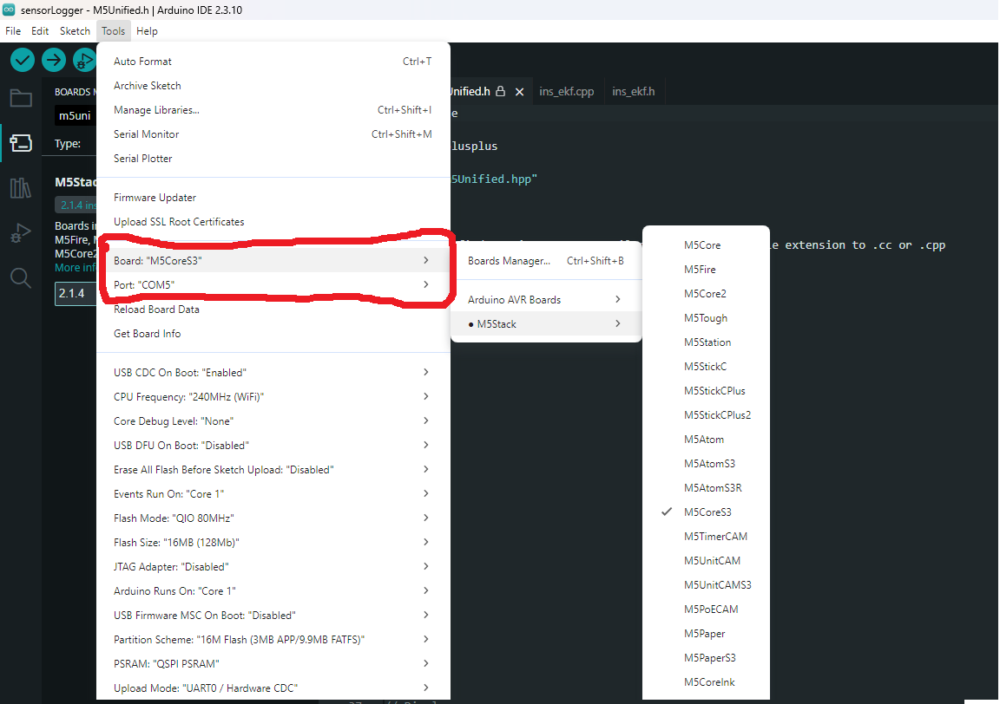
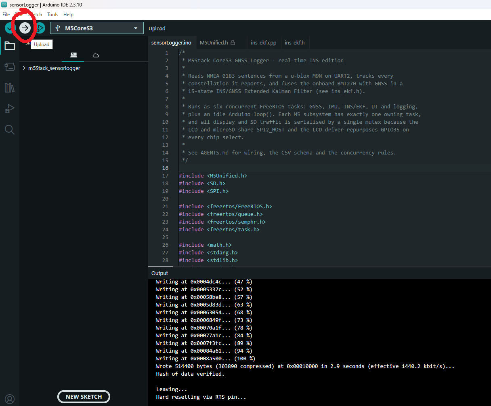

# M5Stack CoreS3 GNSS/INS Logger

A self-contained GNSS + INS data logger for the **M5Stack CoreS3**. It reads NMEA 0183 from a **u-blox M9N**, tracks satellites from GPS, Galileo, BeiDou, GLONASS, QZSS and SBAS, fuses the onboard BMI270 IMU in a **15-state INS/GNSS Extended Kalman Filter** at 100 Hz, shows live data on the LCD, and logs timestamped samples to a microSD card.

The firmware has **no external NMEA parser and no RTOS library dependency**: the NMEA parser is in the sketch, and FreeRTOS is provided by the ESP32 Arduino core installed with the M5Stack board package.

## Quick start

1. Install **Arduino IDE 2.x**.
2. Add the M5Stack board manager URL and install the **M5Stack** board package.
3. Install the **M5Unified** library (accept **M5GFX** and the other dependencies when prompted).
4. Select **M5CoreS3** and the correct COM port.
5. Open `sensorLogger/sensorLogger.ino` — the **folder**, not the repo root — and upload.

> [!NOTE]
> **You do not need to install FreeRTOS.** It ships with the M5Stack/ESP32 board package. See [Do I need to install FreeRTOS?](#4-do-i-need-to-install-freertos) for details.

## Features

- **Multi-constellation GNSS** — GPS, Galileo, BeiDou, GLONASS, QZSS and SBAS, with satellites tracked per constellation.
- **15-state INS/GNSS EKF** — position, velocity, attitude, accelerometer bias and gyro bias; 100 Hz propagation, GNSS position/velocity aiding, ZUPT and magnetometer heading aiding.
- **In-sketch NMEA parser** — no TinyGPSPlus or other parsing library; accepts GGA, RMC and GSV, validates checksums, rejects overlong sentences.
- **Six display pages** — SD/battery, INS, GNSS, satellite SNR, IMU and trajectory.
- **10 Hz CSV logging** — 44 columns covering raw GNSS, IMU, per-constellation satellite counts and INS output.
- **FreeRTOS task layout** — GNSS, IMU, INS/EKF, UI and logging each run in their own task; display and SD access are serialised because they share an SPI bus.
- **Host-tested filter** — `ins_ekf.cpp` has no Arduino dependencies and is covered by a PC unit-test suite.

## Hardware

| Item | Notes |
|---|---|
| M5Stack CoreS3 | ESP32-S3, 16 MB flash, 8 MB PSRAM, 320×240 LCD, BMI270 + BMM150 IMU |
| M5Stack Module GNSS | Stackable u-blox NEO-M9N module with active antenna; DIP switches select the UART pins |
| M5Stack DinBase | Ships with the CoreS3; DC 9–24 V input and power switch (USB-C power also works) |
| GNSS antenna | Active antenna supplied with the module; needs a clear view of the sky |
| microSD card | FAT32; high-endurance card recommended for logging |
| USB-C cable | Data-capable cable, not charge-only |



*CoreS3 on the DinBase: DC 9–24 V input, power switch and microSD slot. The RESET (RST) button is on the side of the CoreS3.*

### GNSS wiring and DIP switches

The firmware expects the Module GNSS on **UART2** at **38400 8N1**:

| GNSS module | CoreS3 |
|---|---|
| TX | GPIO **18** (ESP32 RX) |
| RX | GPIO **17** (ESP32 TX) |
| GND | GND |

The module stacks with the CoreS3 and is powered through the stack. Its DIP switches select which CoreS3 pins the UART uses. **Power the module off before changing them.** Set the switches for the CoreS3 so that:

- **module TX → GPIO18** (the ESP32's RX pin)
- **module RX → GPIO17** (the ESP32's TX pin)

PPS is not used by this firmware. The pin map on the module is shown below; use the **CoreS3** column.



*Module GNSS pin map and DIP switches. The firmware uses the CoreS3 pair GPIO18 (RX) / GPIO17 (TX); module TX crosses to GPIO18 and module RX to GPIO17.*

If your wiring differs, change `GNSS_RX_PIN`, `GNSS_TX_PIN` and `GNSS_BAUD` at the top of the sketch.

If your module is configured for a different baud rate (some u-blox modules default to 9600), change `GNSS_BAUD` or reconfigure the receiver with u-center.

At boot the firmware sends `UBX-CFG-GNSS` to enable GPS, SBAS, Galileo, BeiDou, QZSS and GLONASS. This configuration is volatile and is re-sent on every boot; no u-center step is required. The module must be a u-blox receiver that accepts UBX configuration.

### microSD

The LCD and microSD share the SPI bus, and the CoreS3 LCD driver reuses GPIO35 for MISO/D-C. The firmware serialises every display and SD transaction with a mutex; no special wiring or configuration is needed. Logging stops if the card is removed while running.

## Software setup (Arduino IDE)

### Tested versions

| Software | Version |
|---|---|
| Arduino IDE | 2.3.10 |
| M5Stack board package | 2.1.4 |
| M5Unified | 0.2.5 |
| M5GFX | 0.2.7 |
| FreeRTOS | bundled with the board package |
| TinyGPSPlus | **not used — do not install** |

This firmware was built and tested with the versions above. If a newer board package or library causes build errors, use the version drop-downs in Boards Manager / Library Manager to install these versions.

### 1. Install Arduino IDE

Download **Arduino IDE 2.x** from [arduino.cc/en/software](https://www.arduino.cc/en/software) and install it. The screenshots below use IDE 2.3.10.

### 2. Add the M5Stack board manager URL

1. Open **File → Preferences** (Windows/Linux) or **Arduino IDE → Settings** (macOS).
2. Find **Additional boards manager URLs**.
3. Add:

   ```
   https://static-cdn.m5stack.com/resource/arduino/package_m5stack_index.json
   ```

4. Click **OK**.

### 3. Install the M5Stack board package

Open **Tools → Board → Boards Manager**, search for **M5Stack**, and install **M5Stack by M5Stack official**.



*The screenshot shows the board package (2.1.4) installed in Boards Manager. This package installs the ESP32 Arduino core, toolchain and FreeRTOS.*

> [!IMPORTANT]
> **FreeRTOS is included with this board package.** It is not a separate Library Manager entry, and you should not install an RTOS library manually. See the next section.

### 4. Do I need to install FreeRTOS?

**No.** FreeRTOS is part of the ESP32 Arduino core that comes with the M5Stack board package. It is not listed in Library Manager, and that is expected. The sketch uses the standard headers:

```cpp
#include <freertos/FreeRTOS.h>
#include <freertos/task.h>
#include <freertos/queue.h>
#include <freertos/semphr.h>
```

These resolve automatically once the board package is installed and **M5CoreS3** is selected. The tasks are created in `setup()` with `xTaskCreatePinnedToCore()`; the Arduino `loop()` is intentionally left idle.

If the compiler reports `freertos/FreeRTOS.h: No such file or directory`, the board package is missing or the wrong board is selected — not a missing library.

### 5. Install the M5Unified library

The board package provides the toolchain, but **not** the M5Unified library.

1. Open **Tools → Manage Libraries…**
2. Search for **M5Unified** (by M5Stack) and click **Install**.
3. Accept the prompt to install **M5GFX** and any other dependencies. If M5GFX is not installed automatically, search for **M5GFX** and install it as well.

Do **not** install TinyGPSPlus — this firmware contains its own NMEA parser.

### 6. Select the board and port

1. Connect the CoreS3 with a USB-C data cable.
2. Open **Tools → Board → M5Stack → M5CoreS3**.
3. Open **Tools → Port** and select the COM port that appears when the board is connected (for example `COM5`).



*Tools → Board → M5CoreS3, then select the port. The screenshot also shows the tested Tools settings, including **USB CDC On Boot: Enabled**.*

Recommended **Tools** settings:

| Setting | Value |
|---|---|
| Board | `M5CoreS3` |
| USB CDC On Boot | **Enabled** — required for the USB serial monitor |
| Upload Mode | `UART0 / Hardware CDC` |
| CPU Frequency | `240MHz` |
| Flash Size | `16MB` |

The remaining settings can stay at the board defaults. If the serial monitor is blank after uploading, check **USB CDC On Boot** first.

### 7. Open the sketch

Clone the repository or download it as a ZIP:

```bash
git clone https://github.com/lbyRepo/M5Stack-GNSS-Logger.git
```

In Arduino IDE use **File → Open…** and select:

```
sensorLogger/sensorLogger.ino
```

Open the `sensorLogger` folder/sketch, **not the repository root**. Arduino requires the sketch folder name to match the `.ino` filename, and the sketch uses the local files `ins_ekf.h` and `ins_ekf.cpp`.

### 8. Compile and upload

1. Click **Verify** (check mark) to compile. The first build takes a few minutes.
2. Click **Upload** (right arrow).



*Uploading from the Arduino IDE. The Output pane shows the flash write and the automatic reset.*

If the upload fails:

- Close the Serial Monitor.
- Put the CoreS3 in download mode: press and hold the **RESET (RST)** button for about **3 seconds**; when the green indicator LED lights, release it.
- Re-select the COM port and upload again.

### 9. Serial monitor

Open **Tools → Serial Monitor** at **115200 baud**. After reset you should see messages such as:

```
UBX-CFG-GNSS sent (GPS/SBAS/Galileo/BeiDou/QZSS/GLONASS)
Logging to /log.csv
Tasks started
```

Every 5 seconds a `TEL ...` line reports measured IMU/EKF/GNSS rates, logged rows and error counters. Once alignment completes, a one-shot line reports the measured IMU means:

```
ALIGN acc=(...) gyro=(...)
```

## First run

Before powering on, check that the configured [mounting and axis mapping](#mounting-and-axis-mapping) matches how the CoreS3 is strapped down.

1. Insert a FAT32-formatted microSD card.
2. Connect the GNSS antenna and place the logger outdoors with a clear view of the sky.
3. Power on and **keep the device still**.
4. Wait for the first valid GNSS fix. The INS page (page 2) shows the mode:
   - `WAIT` — waiting for the first GNSS fix.
   - `ALGN` — collecting 2 seconds of static IMU samples. Do not move the device.
   - `RUN` — the filter is running and logging INS output.
5. Press the **PWR** button to cycle through the six display pages.
6. Logging begins automatically at 10 Hz; page 1 shows the active log file and SD card usage.

If you move the device during `ALGN`, power-cycle it and repeat the stationary alignment.

## Display pages

| Page | Contents |
|---|---|
| 1 | SD card capacity and battery voltage/level |
| 2 | INS mode, position, velocity, attitude, biases, loop rates and stack watermark |
| 3 | GNSS summary: UTC time, satellites used, per-constellation satellites in view, position, height, speed, heading |
| 4 | Satellite SNR, strongest fresh satellites, three columns |
| 5 | IMU accelerometer, gyroscope, magnetometer and temperature |
| 6 | North/east trajectory from the first fix |

Button: **PWR** cycles pages. Touch input is not used.

## Logging

- Files are written to the microSD root as `/log.csv`, `/log_1.csv`, `/log_2.csv`, …; an existing file is never overwritten.
- Rows are written at **10 Hz** (`SD_CARD_LOGGING_RATE_MS`). The file stays open and is flushed every 5 seconds.
- GNSS values repeat between fixes; the IMU and INS values are updated at the row rate.
- `date` and `time` are local time (UTC + `TIMEZONE_OFFSET_HRS`, default +8). `utc_time` is UTC in `HHMMSS` form and `pc_time_s` is seconds since boot with millisecond resolution.
- `ins_hgt_wgs84_m` is ellipsoidal height, matching the INS mechanisation.
- If no SD card is present, page 1 shows `No SD card` and no rows are logged.

The 44-column header is:

<details>
<summary>Show CSV header</summary>

```text
pc_time_s,utc_time,date,time,numsat,lat_deg,lon_deg,hgt_msl_m,hgt_wgs84_m,geoid_separation_m,speed_ms,heading_deg,ax_ms2,ay_ms2,az_ms2,gx_rads,gy_rads,gz_rads,mx_uT,my_uT,mz_uT,temp_degC,inview_gps,inview_gal,inview_bds,inview_glo,inview_qzss,inview_sbas,ins_lat_deg,ins_lon_deg,ins_hgt_wgs84_m,ins_vn_ms,ins_ve_ms,ins_vd_ms,ins_roll_deg,ins_pitch_deg,ins_yaw_deg,ins_bax_ms2,ins_bay_ms2,ins_baz_ms2,ins_bgx_degs,ins_bgy_degs,ins_bgz_degs,ins_status
```

</details>

`ins_status` is bit-packed:

| Bits | Meaning |
|---|---|
| 0–1 | Mode: 0 = wait, 1 = align, 2 = run |
| 2 | ZUPT active |
| 3 | Magnetometer heading active |

If you change the CSV columns, update **both** `CSV_HEADER` and the `printf` in `logNavRow()`. Column names are only appended, so existing column indices remain stable.

## Configuration

### Sketch settings — `sensorLogger/sensorLogger.ino`

| Constant | Default | Purpose |
|---|---|---|
| `GNSS_RX_PIN` / `GNSS_TX_PIN` | 18 / 17 | UART2 pins |
| `GNSS_BAUD` | 38400 | GNSS module baud rate |
| `UBX_CONFIGURE_GNSS` | `true` | Send the u-blox constellation configuration at boot |
| `TIMEZONE_OFFSET_HRS` | 8 | Local-time offset used for `date` / `time` |
| `SD_CARD_LOGGING_RATE_MS` | 100 | CSV row interval (10 Hz) |
| `UI_REFRESH_MS` | 200 | LCD refresh interval |

### Filter settings — `sensorLogger/ins_ekf.h`

| Constant | Default | Purpose |
|---|---|---|
| `MAG_DECLINATION_DEG` | `0.0` | Magnetic declination for true heading; set for your location |
| `MAG_HARD_IRON_UT` | `{0,0,0}` | Magnetometer hard-iron offsets in body FRD, applied after mapping |
| `IMU_TO_BODY` | `(Y, X, -Z)` | M5Unified-to-body rotation for the mounting below — **verify on hardware** |
| `ZUPT_ENABLE` | `true` | Zero-velocity updates while stationary |
| `MAG_AIDING_ENABLE` | `true` | Magnetometer heading updates while stationary |
| `GNSS_LATENCY_MS` | `150` | Assumed GNSS latency used by the filter |

### Mounting and axis mapping

**The INS axis mapping depends on how the CoreS3 is strapped down.** The default assumes the **screen faces up and the DC-input side faces the wearer**, with forward travel pointing away from that side. The DC-input connector, not USB-C, identifies the rear for this mounting.

The filter uses a right-handed **FRD body frame: X forward, Y right, Z down**. In the default mounting, M5Unified reports X to the wearer's right, Y forward, and Z upward out of the screen, so the conversion is:

| INS body component | M5Unified component |
|---|---|
| X / forward | +Y |
| Y / right | +X |
| Z / down | -Z |

Configure this rotation with `IMU_TO_BODY` in [`sensorLogger/ins_ekf.h`](sensorLogger/ins_ekf.h):

```cpp
constexpr float IMU_TO_BODY[3][3] = {
  {0.0f, 1.0f,  0.0f},
  {1.0f, 0.0f,  0.0f},
  {0.0f, 0.0f, -1.0f},
};
```

Each row selects the sensor components for forward, right and down respectively. If you rotate the device, mount it vertically, or strap it to a different surface, update this matrix and rebuild. Use an orthonormal rotation with determinant +1; flipping only one axis creates a reflection. For example, **screen up with USB-C toward the wearer** instead requires `(X, -Y, -Z)`. An oblique mounting requires a measured rotation rather than only axis swaps and sign changes. Screen/display rotation does not change the IMU mounting.

`updateImu()` applies the rotation to accelerometer and gyro inputs, and `updateMag()` applies it to magnetometer inputs. Pass M5Unified-frame vectors into these APIs; do not pre-rotate them again. M5Unified already corrects the BMM150 chip orientation. `MAG_HARD_IRON_UT` is expressed in the resulting body frame, so rotate any calibrated offsets when changing the mounting. Page 5 and the original sensor CSV columns retain M5Unified axes; INS attitude and biases use the mapped body frame.

Verify on hardware before relying on the INS:

- With the default mounting level and stationary, page 5 should show acceleration near `(0, 0, +9.8)` m/s². The mapped serial `ALIGN acc=(...)` should show approximately `(0, 0, -9.8)`, and INS roll/pitch should be near zero.
- Raise the edge opposite the DC input: sensor Y acceleration should become positive. Raise the right edge: sensor X should become positive. These checks distinguish the horizontal axes, which a level test cannot do.
- Turn right while level: sensor gyro Z should be negative, corresponding to positive body yaw rate. Use timestamped readings to check rotations; the display refresh is slow.

Keep the device fixed relative to the intended body frame. If it swings or rotates independently while walking, its forward axis no longer necessarily follows your direction of travel. A correct mapping is necessary for navigation but does not replace magnetometer calibration or a correct declination setting.

## Repository layout

| Path | Description |
|---|---|
| `sensorLogger/sensorLogger.ino` | Application, FreeRTOS tasks, display, logging, NMEA parser, UBX configuration |
| `sensorLogger/ins_ekf.h` | INS/EKF public API, state definition and tuning constants |
| `sensorLogger/ins_ekf.cpp` | Strapdown mechanisation and 15-state error-state EKF; no Arduino dependencies |
| `test/host/test_ins.cpp` | Host unit tests for the INS/EKF |
| `test/host/run_tests.bat` | Builds and runs the host tests with MSVC |
| `assets/` | Screenshots used in this README |
| `AGENTS.md` | Detailed architecture, concurrency and data-format notes |

## Host tests (optional)

The EKF is deliberately free of Arduino dependencies, so it can be tested on a PC.

Requirements: **Visual Studio 2022** with the **Desktop development with C++** workload.

```bat
test\host\run_tests.bat
```

The suite covers quaternions, geodesy, alignment, stationary hold/ZUPT, covariance health, GNSS aiding, timestamp handling, latency compensation and attitude observability. Last run: **45 passed, 0 failed**.

`run_tests.bat` calls the Visual Studio Community 2022 `vcvars64.bat` path. If you use Build Tools, Professional or a different install location, edit that line in the batch file.

## Command-line build (optional)

With `arduino-cli` installed:

```bash
arduino-cli compile --fqbn m5stack:esp32:m5stack_cores3 --build-path .build sensorLogger
arduino-cli upload -p COM5 --fqbn m5stack:esp32:m5stack_cores3 --build-path .build sensorLogger
```

Replace `COM5` with your port.

## Troubleshooting

| Problem | Things to check |
|---|---|
| `M5CoreS3` not listed under Tools → Board | Board manager URL added correctly; **M5Stack** board package installed |
| No COM port | Use a data-capable USB-C cable; try another port; install/allow the USB serial driver; use download mode |
| Upload fails | Close the Serial Monitor; enter download mode (hold **RESET** ~3 s until the green LED lights); re-select the port |
| Serial Monitor is blank | **USB CDC On Boot: Enabled**; 115200 baud; correct port; press reset after opening the monitor |
| `freertos/FreeRTOS.h: No such file or directory` | Board package not installed, or wrong board selected — FreeRTOS is bundled, not a Library Manager install |
| `ins_ekf.h: No such file or directory` | Open `sensorLogger/sensorLogger.ino` (the whole sketch folder), not the repo root or a single copied file |
| GNSS never gets a fix | Antenna connected and outdoors; module TX→GPIO18, RX→GPIO17; 38400 baud; module powered; u-blox M9N compatible |
| INS stays in `WAIT` | No valid GNSS fix yet; check the GNSS page and antenna |
| INS stays in `ALGN` | Keep the device completely still for 2 seconds; if it was moved, power-cycle |
| Yaw drifts or is wrong | Set `MAG_DECLINATION_DEG`, calibrate `MAG_HARD_IRON_UT`, verify `IMU_TO_BODY` against `ALIGN acc=(...)` |
| No log file / logging stops | FAT32 card inserted correctly; check page 1; a card removed mid-session stops logging until reset |
| Build fails after updating packages | Install the tested versions (M5Stack 2.1.4, M5Unified 0.2.5, M5GFX 0.2.7) via the version drop-downs |

## Notes and limitations

- This is an experimental logger, not a certified navigation or surveying instrument.
- The INS assumes it is **stationary during the initial 2-second alignment**. Moving during alignment degrades the initial attitude and biases.
- Heading accuracy depends on magnetometer calibration and declination; the defaults are uncalibrated.
- GNSS latency compensation assumes 150 ms. Change `GNSS_LATENCY_MS` if your receiver/configuration differs.
- The BMI270 ODR is not configured by M5Unified and runs at roughly 100 Hz, which caps the INS propagation rate near 100 Hz.
- The design targets a u-blox M9N at 38400 baud; the UBX constellation configuration is u-blox-specific.

## Further reading

- [M5Stack CoreS3 documentation](https://docs.m5stack.com/en/core/CoreS3)
- [M5Stack Arduino quick start](https://docs.m5stack.com/en/arduino/m5cores3/program)
- [Module GNSS DIP-switch and pin-mapping guide](https://docs.m5stack.com/en/guide/dip_switch/module_gnss/pins_change)
- `AGENTS.md` — task layout, locking rules, NMEA parser details and the full CSV schema
- `sensorLogger/ins_ekf.h` — filter state definition, tuning and frame conventions
- Titterton & Weston, *Strapdown Inertial Navigation Technology* (2nd ed.) — mechanisation reference
